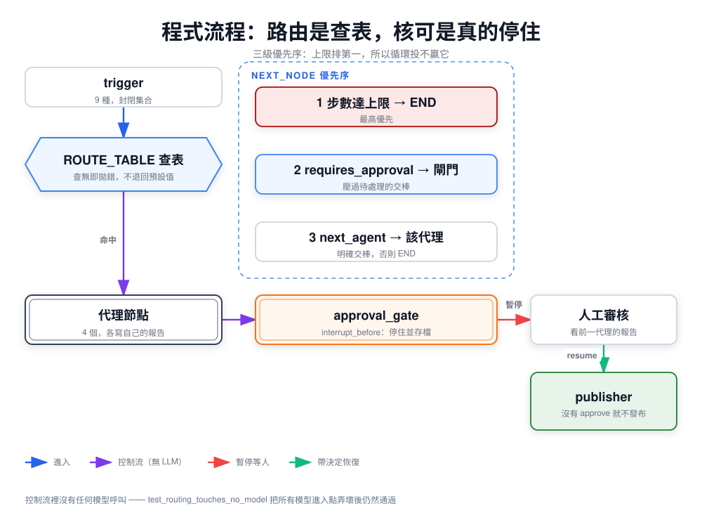
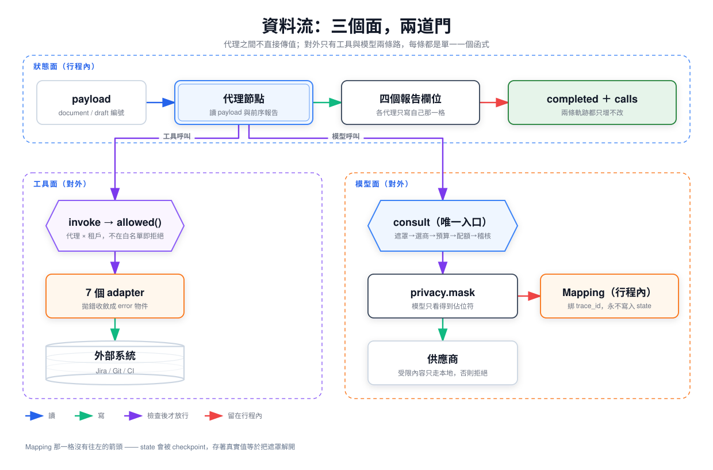
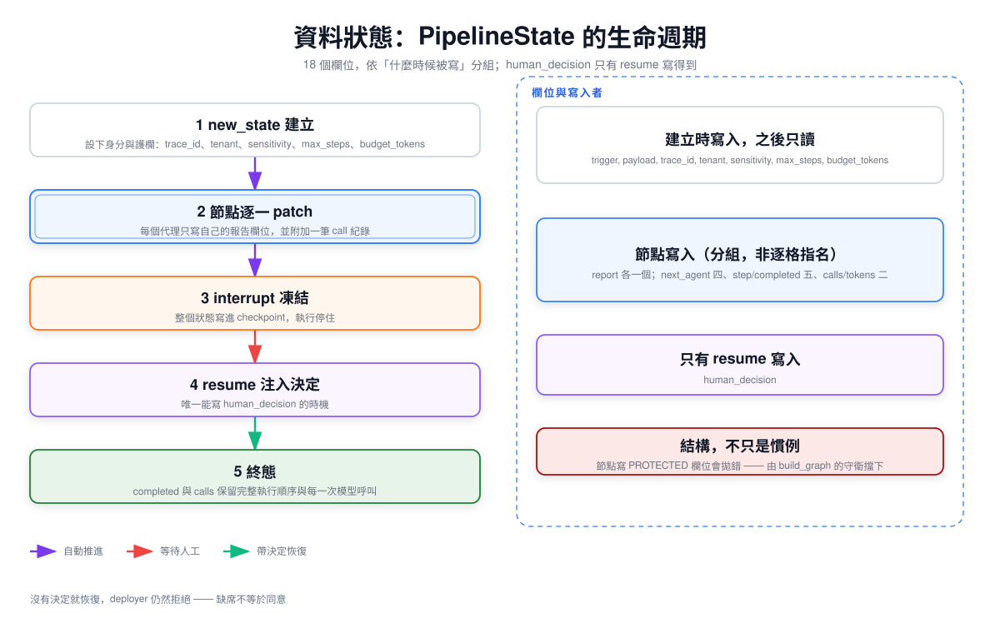
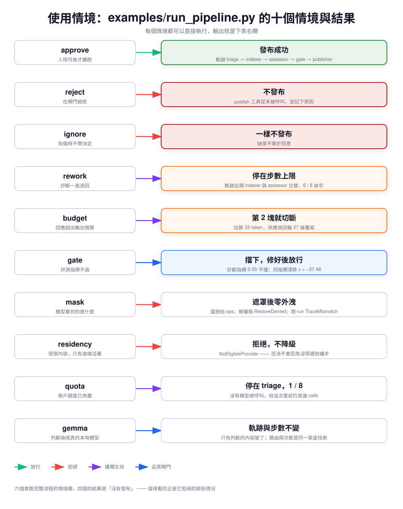

*English ｜ [繁體中文](architecture.zh-TW.md)*

# Architecture — four views

[`design.md`](design.md) argues *why* the control plane is ordinary code.
This page shows *what the code actually does*, in four views.

Diagrams are generated from JSON in [`src/`](src); edit the JSON and
re-render rather than hand-editing the SVG.

---

## 1. Control flow



`route()` turns a trigger into an entry node. After every node,
`next_node()` applies a fixed precedence: the step guard first, then a
pending approval, then an explicit hand-off, then stop. The guard is first
so a cycle cannot out-vote it.

`approval_gate` is compiled with `interrupt_before`, so reaching it stops
the run and checkpoints it. The publisher is reached on both the approved
and the unapproved path — the refusal lives *inside* the publisher, which
is why "resume with no decision" still cannot publish.

Source: [`router.py`](../src/agentcp/router.py), [`graph.py`](../src/agentcp/graph.py)

## 2. Data flow



Three surfaces, and a node reaches the outside world through exactly
two of them — each a single function.

**The state surface** is in-process. Agents never pass values to each
other; they read `payload` and prior reports from `PipelineState` and write
exactly one `*_report` slot each. `completed` and `calls` are append-only,
so the audit trail cannot be rewritten by a later node.

**The tool surface** is one way out. Every call goes through `invoke`,
which checks the agent against `allowed(agent, tenant)` before the adapter
runs. An adapter that raises is converted to an error object, so an
exception never reaches the graph and a broken integration cannot kill a
run that is holding an approval. Whether the *step* degrades is the
caller's half of that bargain, and no caller here inspects the key yet —
[`errata.md`](errata.md), D4.

**The model surface** is the other, and it is `consult` — the only place
in the package a `Judge` is called. Masking, provider selection, the
budget, the quota and the audit record all sit behind that one function,
so they are not things a node has to remember. A second entry point would
make every one of them optional, which is why
`test_only_consult_contains_a_call_to_the_injected_judge` exists.

What does *not* cross any surface is the unmasking map. It is returned to
the caller in process and never written to state, because state is
checkpointed and a checkpoint holding real values would undo the masking
exactly where the data rests.

Source: [`state.py`](../src/agentcp/state.py), [`tools.py`](../src/agentcp/tools.py), [`agents.py`](../src/agentcp/agents.py), [`privacy.py`](../src/agentcp/privacy.py), [`providers.py`](../src/agentcp/providers.py)

## 3. Data state



There are 18 fields. One writer each holds for the four `*_report` slots
and for `human_decision`; it does not hold for the rest. `next_agent` is
written by four nodes, `step_count` and `completed` by five (every node
goes through `_advance`), `calls` and `tokens_used` by two, and
`requires_approval` by two — the assessor sets it and the gate clears it.
The diagram groups those under "written by nodes" rather than naming each,
so it shows *when* a field is written rather than by whom.

The row that matters is `human_decision`: the only thing that writes it
is a resume carrying a decision, and a node that tries raises
`ProtectedFieldWritten`. That is now a property of the graph rather than
of the nodes that happen to exist — `build_graph` wraps every node and
refuses a patch naming anything in `state.PROTECTED`, which is also what
protects `max_steps`, `sensitivity`, `tenant` and `trace_id`.

It was a convention until recently: `PipelineState` is a bare `TypedDict`,
`graph.py` merged a node's patch in unchanged, and a node that wrote
`human_decision` forged a human approval that nothing rejected — resuming
with *no* decision then published, straight through the check that is
supposed to prevent exactly that. Entry A1 in [`errata.md`](errata.md)
keeps the record, because how a claim came to outrun its evidence is
worth more than the repaired sentence.

`next_agent` is deliberately not protected: handing off is what a node is
for. A node can still route past the gate, and what stops the publish is
the publisher's own refusal — the decision it needs is the field that
cannot be forged.

Four fields are set once at `new_state` and only read afterwards —
`trace_id`, `tenant`, `sensitivity`, `max_steps`. They are the run's
identity and its constraints, and nothing during the run may relax them.
Giving each an explicit value at creation rather than defaulting it at the
point of use is deliberate: "unset" and "set to the default" should not
read the same.

Source: [`state.py`](../src/agentcp/state.py), [`agents.py`](../src/agentcp/agents.py), [`audit.py`](../src/agentcp/audit.py)

## 4. Usage scenarios



The scenarios in [`examples/run_pipeline.py`](../examples/run_pipeline.py).
Each is runnable:

```bash
uv run --with langgraph python examples/run_pipeline.py approve
```

Most of them end in "did not publish", which is the intended shape: the
interesting cases for a publishing pipeline are the ones where it declines,
and there are more ways to decline than to proceed.

---

| View | Tests that pin it |
|---|---|
| Control flow | `test_routing.py`, `test_handoff.py`, `test_judgement_boundary.py` |
| Data flow | `test_tool_access.py`, `test_privacy.py`, `test_providers.py` |
| Data state | `test_hitl.py`, `test_audit.py`, `test_state_protection.py` |
| Scenarios | all fourteen test files |

What this page does not cover is the boundary itself — which
capabilities of the original system are here, which were left out, and
why. That is [`scope.md`](scope.md).
