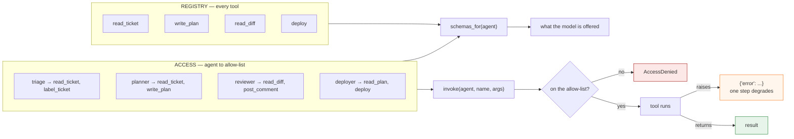
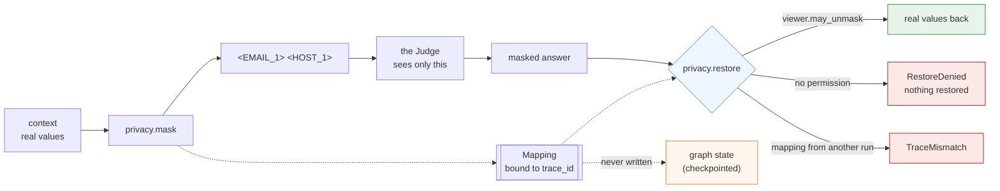
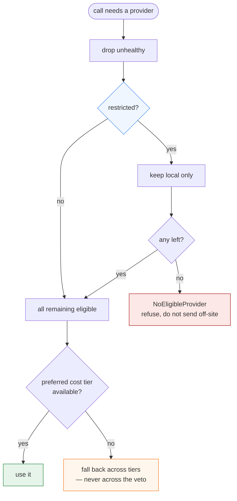

*English ｜ [繁體中文](design.zh-TW.md)*

# Design notes

Four diagrams for four claims: routing is a table, permission is a
check, masking is one mechanism with three endpoints, and sensitivity
is a veto rather than a weight.

---

## 1. The control plane is a table, and approval is a real stop

`route()` picks the entry node from `trigger`. After every node,
`next_node()` applies a fixed precedence — the step guard first, then a
pending approval, then an explicit hand-off. The guard is first so that a
cycle cannot out-vote it.

The dashed edge is the only place the system waits for a person, and it is
enforced by the runtime rather than by a node remembering to check.

**Precedence matters, and is tested:** `test_step_budget_outranks_a_pending_handoff`
sets `next_agent` *and* `requires_approval` on an over-budget state and
asserts the run still ends.

---

## 2. Permission is checked at the call, and advertised from the same table

A prompt saying "do not deploy" is a request. `ACCESS` is a check. The
schemas offered to a model are generated from that same table, so a tool
cannot be advertised to an agent that is forbidden to run it.

`test_schemas_offered_match_the_allow_list` asserts the two outputs of that
shared table agree, for every agent. Without it, the offer and the check
drift the first time someone adds a tool.

---

## 3. Masking, restoring and the permission are one mechanism

The model is shown `<EMAIL_1>`. The person reading the answer needs the
real address back, or the answer is not actionable. So the value has to
return for *someone*, which makes the question "who", which means there
has to be a check — and the check belongs next to the mapping, not in
whatever layer happens to render the response.

Split these three across a gateway, a view and a template and nothing
can assert that a value masked on the way out is restorable only to
someone entitled to it. That is how the guarantee is lost.

Two refusals rather than one best effort. A partial restore is the worst
available outcome: it still leaks, and it reads as though nothing was
withheld. `test_restore_refuses_outright_rather_than_restoring_part`
pins that.

The dotted edge to state is the one that is *not* there. State gets
checkpointed; a checkpoint holding the mapping would undo the masking at
rest, so the mapping stays in process and
`test_the_unmasking_map_never_reaches_checkpointed_state` asserts it.

---

## 4. Sensitivity is a veto; cost is a preference

Three axes decide which provider sees a call, and they are not peers.
Order of application is the entire policy, which is why `choose` is
written as three filters in sequence rather than a score.

The branch worth reading is `E -->|no| X`. When the only healthy
provider is remote and the content is restricted, the answer is "no
provider", not "just this once". A veto that bends under load is a
preference with better marketing —
`test_failover_may_not_cross_the_locality_veto` is the test that keeps
it one.

Every `Choice` also carries the reason it was made, which is what the
audit record stores. "Which provider" without "why that provider" is
not answerable after the fact once the health picture has changed.

---

## 5. Where each claim is tested

| Claim | Test |
|---|---|
| Same trigger always routes the same way | `test_same_trigger_always_routes_to_same_agent` |
| The trigger type and the route table cannot drift | `test_every_trigger_in_the_type_has_a_route` |
| An unknown trigger raises rather than defaulting | `test_unknown_trigger_raises_instead_of_defaulting` |
| No model is reachable from the control plane | `test_routing_touches_no_model` |
| The step guard beats a hand-off and an approval | `test_step_budget_outranks_a_pending_handoff` |
| The run genuinely pauses at the gate | `test_run_actually_stops_at_the_gate` |
| Absence of a decision is not consent | `test_resuming_with_no_decision_still_refuses_to_deploy` |
| The reviewer does not write `human_decision` | `test_the_reviewer_cannot_approve_on_the_humans_behalf` |
| Offered schemas equal the allow-list | `test_schemas_offered_match_the_allow_list` |
| A raising tool degrades one step | `test_a_raising_tool_degrades_instead_of_crashing` |
| The budget bites mid-stream | `test_stream_is_cut_mid_way_not_after_the_fact` |
| The real count replaces the estimate | `test_real_usage_overwrites_the_estimate` |
| A diagnostic metric never gates | `test_the_diagnostic_metric_never_blocks_however_bad` |
| Both metric directions share one comparison | `test_both_directions_report_negative_z_when_worse` |
| A short window is not "ok" | `test_short_window_is_insufficient_data_not_ok` |
| The masked text leaks nothing, checked whole | `test_masked_text_contains_no_real_value_anywhere` |
| Restoring refuses rather than restoring part | `test_restore_refuses_outright_rather_than_restoring_part` |
| One run's mapping cannot resolve another's | `test_a_mapping_from_another_run_cannot_resolve_this_one` |
| The judge only ever sees masked text | `test_the_judge_only_ever_sees_masked_text` |
| The unmasking map never reaches state | `test_the_unmasking_map_never_reaches_checkpointed_state` |
| Restricted content never reaches a remote provider | `test_restricted_content_never_reaches_a_remote_provider` |
| Failover crosses cost but not locality | `test_failover_may_not_cross_the_locality_veto` |
| Every model call goes through one door | `test_consult_is_the_only_place_a_judge_is_called` |
| A refused call still leaves a record | `test_a_refused_call_still_leaves_a_record` |
| The run's token counter is actually charged | `test_the_run_token_counter_is_actually_charged` |
| A tenant rule narrows, never grants | `test_a_tenant_rule_can_only_subtract_never_grant` |
| Schemas match the allow-list per agent *and* tenant | `test_schemas_match_the_allow_list_for_every_agent_and_tenant` |
| One tenant's exhaustion does not touch another | `test_one_tenant_running_out_does_not_touch_another` |
| An over-quota error says when to retry | `test_the_error_says_when_to_come_back` |
| Raising a bar does not rewrite old verdicts | `test_raising_the_bar_later_does_not_rewrite_an_earlier_verdict` |
| Required durability refuses MemorySaver | `test_passing_memorysaver_does_not_satisfy_the_requirement` |
