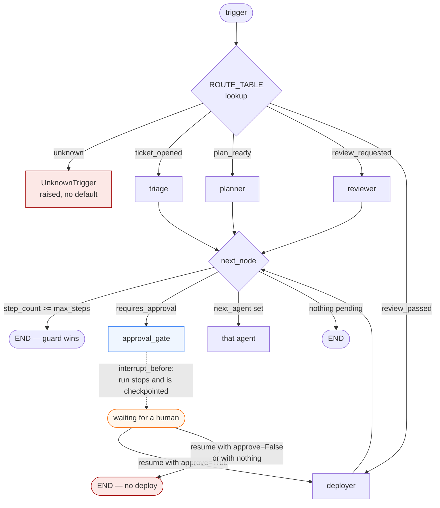
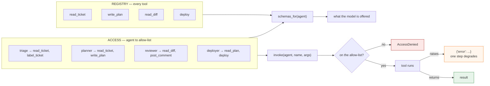

*English ｜ [繁體中文](design.zh-TW.md)*

# Design notes

Two diagrams for the two claims the README makes.

---

## 1. The control plane is a table, and approval is a real stop

`route()` picks the entry node from `trigger`. After every node,
`next_node()` applies a fixed precedence — the step guard first, then a
pending approval, then an explicit hand-off. The guard is first so that a
cycle cannot out-vote it.

The dashed edge is the only place the system waits for a person, and it is
enforced by the runtime rather than by a node remembering to check.

**Precedence matters, and is tested:** `test_step_budget_outranks_a_pending_handoff`
sets `next_agent` *and* `requires_approval` on an over-budget state and
asserts the run still ends.

---

## 2. Permission is checked at the call, and advertised from the same table

A prompt saying "do not deploy" is a request. `ACCESS` is a check. The
schemas offered to a model are generated from that same table, so a tool
cannot be advertised to an agent that is forbidden to run it.

`test_schemas_offered_match_the_allow_list` asserts the two outputs of that
shared table agree, for every agent. Without it, the offer and the check
drift the first time someone adds a tool.

---

## Where each claim is tested

| Claim | Test |
|---|---|
| Same trigger always routes the same way | `test_same_trigger_always_routes_to_same_agent` |
| The trigger type and the route table cannot drift | `test_every_trigger_in_the_type_has_a_route` |
| An unknown trigger raises rather than defaulting | `test_unknown_trigger_raises_instead_of_defaulting` |
| No model is reachable from the control plane | `test_routing_touches_no_model` |
| The step guard beats a hand-off and an approval | `test_step_budget_outranks_a_pending_handoff` |
| The run genuinely pauses at the gate | `test_run_actually_stops_at_the_gate` |
| Absence of a decision is not consent | `test_resuming_with_no_decision_still_refuses_to_deploy` |
| The reviewer cannot self-approve | `test_the_reviewer_cannot_approve_on_the_humans_behalf` |
| Offered schemas equal the allow-list | `test_schemas_offered_match_the_allow_list` |
| A raising tool degrades one step | `test_a_raising_tool_degrades_instead_of_crashing` |
| The budget bites mid-stream | `test_stream_is_cut_mid_way_not_after_the_fact` |
| The real count replaces the estimate | `test_real_usage_overwrites_the_estimate` |
| A diagnostic metric never gates | `test_the_diagnostic_metric_never_blocks_however_bad` |
| Both metric directions share one comparison | `test_both_directions_report_negative_z_when_worse` |
| A short window is not "ok" | `test_short_window_is_insufficient_data_not_ok` |
