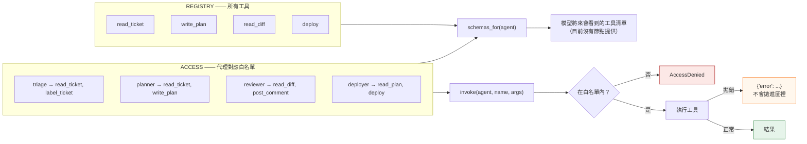
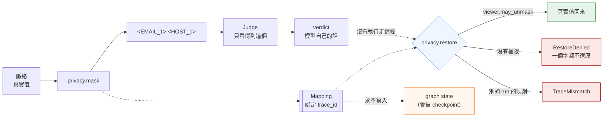
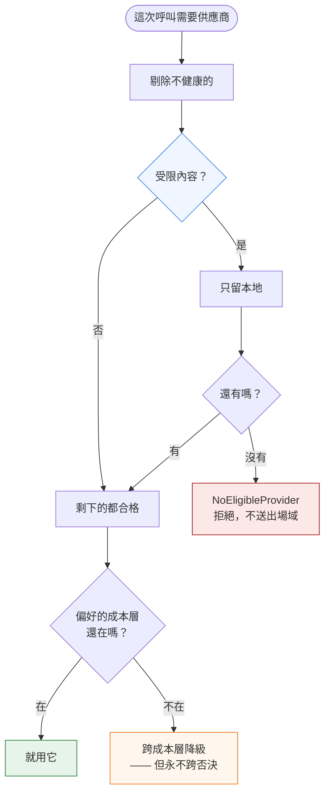

*[English](design.md) ｜ 繁體中文*

# 設計說明

四個主張，各配一張圖：路由是一張表、權限是一道檢查、遮罩是一套機制的三個端點、敏感度是否決而不是權重。

---

## 1. 控制平面是一張表，而核可是真的停住

`route()` 依 `trigger` 決定進入哪個節點。每個節點跑完後，`next_node()` 套用固定的優先序——**步數上限最先，其次是待核可，最後才是明確的交棒**。上限排第一，所以循環投不贏它。

虛線是整個系統唯一會等人的地方，而且是由執行層強制，不是靠某個節點記得要檢查。

**優先序本身是被測的**：`test_step_budget_outranks_a_pending_handoff` 在一個已超過步數上限的狀態上**同時**設了 `next_agent` 和 `requires_approval`，斷言執行仍然結束。

---

## 2. 權限在呼叫點檢查，而「將來要對外宣告」的也是同一張表

提示詞寫「不要部署」是一個請求。`ACCESS` 是一個檢查。`allowed()` 是這張表的唯一來源，兩種讀法都從它來——`invoke` 做檢查、`schemas_for` 做算繪——所以**一個工具不可能被推薦給沒有權限執行它的代理**。這個 repo 沒有任何節點讓模型自己挑工具，所以那層算繪是「將來要接 tool-calling」的那道縫；在還沒有人依賴它之前就把一致性釘住，是這件事裡便宜的那一半，也是唯一可移植的那一半。

`test_schemas_offered_match_the_allow_list` 斷言這張共用表的**兩個輸出對每個代理都一致**。沒有這條，下次有人加工具時「宣告」與「檢查」就會開始各走各的。

---

## 3. 遮罩、還原、權限，是同一套機制的三個端點

模型看到的是 `<EMAIL_1>`。讀這個答案的人需要真實地址回來，否則答案無法執行。所以值一定要為**某個人**回來，於是問題變成「誰」，於是中間一定要有一道檢查——而這道檢查屬於映射旁邊，不屬於碰巧負責把回應畫出來的那一層。

把這三件事拆到閘道、檢視層、樣板三個地方，就沒有任何東西能夠斷言「出去時被遮罩的值，只能還原給有資格的人」。保證就是這樣掉的。

兩種拒絕，而不是一次「盡力而為」。**部分還原是所有可能結果裡最差的那一個**：它照樣外洩，而且讀起來像是什麼都沒被扣住。`test_restore_refuses_outright_rather_than_restoring_part` 釘住這一條。

通往 `restore` 的那條虛線是這張圖最誠實的部分。**一次流水線執行只遮罩，不還原**：被遮罩的是送給 judge 的脈絡，verdict 回來的是模型自己的話，而 `Consultation.mapping` 在行程內回傳後就被丟掉——這件事 [`scope.zh-TW.md`](scope.zh-TW.md) 一直都是照實寫的。真正走到 `restore` 的是 `test_privacy.py` 與 `mask` 情境的直接呼叫。把三個端點放在一起的論證，並不需要一次執行把三個都走過；它論的是「**如果**值會回來，那道檢查該放在哪裡」。但圖不該畫出一條沒有執行會走的路。見 [`errata.md`](errata.md) 的 C2。

通往 state 的那條虛線是**不存在**的那一條。state 會被 checkpoint；一份存著映射的 checkpoint 等於在資料真正躺著的地方把遮罩解開，所以映射留在行程內，由 `test_the_unmasking_map_never_reaches_checkpointed_state` 斷言。

---

## 4. 敏感度是否決，成本只是偏好

三個軸決定哪個供應商看得到這次呼叫，而它們不是平輩。**套用的順序就是整個政策**，這也是為什麼 `choose` 寫成依序三道過濾，而不是算一個分數。

值得讀的是 `E -->|沒有| X` 這條分支。當唯一健康的供應商在遠端、而內容是受限的，答案是「沒有供應商」，不是「就這一次」。**一個在壓力下會彎的否決，只是包裝比較好的偏好**——`test_failover_may_not_cross_the_locality_veto` 就是讓它維持是否決的那條測試。

每個 `Choice` 還帶著「為什麼這樣選」的理由，而那正是稽核紀錄存下來的東西。只有「哪個供應商」而沒有「為什麼是它」，等健康狀態變了之後就再也回答不了。

---

## 5. 每個主張對應哪條測試

| 主張 | 測試 |
|---|---|
| 同一 trigger 永遠走同一條路 | `test_same_trigger_always_routes_to_same_agent` |
| 型別與路由表不可能漂移 | `test_every_trigger_in_the_type_has_a_route` |
| 未知 trigger 拋錯而非預設 | `test_unknown_trigger_raises_instead_of_defaulting` |
| 控制平面碰不到模型 | `test_routing_touches_no_model` |
| 步數上限壓過交棒與核可 | `test_step_budget_outranks_a_pending_handoff` |
| 執行真的停在閘門 | `test_run_actually_stops_at_the_gate` |
| 沒有決定不等於同意 | `test_resuming_with_no_decision_still_refuses_to_deploy` |
| 審查者不寫 `human_decision` | `test_the_reviewer_cannot_approve_on_the_humans_behalf` |
| 宣告的 schema 等於白名單 | `test_schemas_offered_match_the_allow_list` |
| 工具拋錯回傳 error 物件，不往外拋 | `test_a_raising_tool_degrades_instead_of_crashing` |
| 預算在串流中途就咬 | `test_stream_is_cut_mid_way_not_after_the_fact` |
| 真實用量覆寫估算值 | `test_real_usage_overwrites_the_estimate` |
| 診斷指標永不擋發布 | `test_the_diagnostic_metric_never_blocks_however_bad` |
| 兩個方向共用一條比較 | `test_both_directions_report_negative_z_when_worse` |
| 視窗太短不算 ok | `test_short_window_is_insufficient_data_not_ok` |
| 遮罩後整段文字不含任何真實值 | `test_masked_text_contains_no_real_value_anywhere` |
| 沒權限就整段拒絕，不做部分還原 | `test_restore_refuses_outright_rather_than_restoring_part` |
| 一個 run 的映射還原不了另一個 | `test_a_mapping_from_another_run_cannot_resolve_this_one` |
| Judge 只看得到遮罩後的文字 | `test_the_judge_only_ever_sees_masked_text` |
| 還原用的映射不會進到 state | `test_the_unmasking_map_never_reaches_checkpointed_state` |
| 受限內容絕不送到遠端供應商 | `test_restricted_content_never_reaches_a_remote_provider` |
| 容錯跨成本層但不跨地域 | `test_failover_may_not_cross_the_locality_veto` |
| 每次模型呼叫都走同一道門 | `test_consult_is_the_only_place_a_judge_is_called` |
| 被拒絕的呼叫照樣留下紀錄 | `test_a_refused_call_still_leaves_a_record` |
| 執行的 token 計數器真的被扣 | `test_the_run_token_counter_is_actually_charged` |
| 租戶規則只能減、不能給 | `test_a_tenant_rule_can_only_subtract_never_grant` |
| schema 對每個 (代理, 租戶) 都等於白名單 | `test_schemas_match_the_allow_list_for_every_agent_and_tenant` |
| 一個租戶用盡不影響另一個 | `test_one_tenant_running_out_does_not_touch_another` |
| 超額錯誤說得出何時再來 | `test_the_error_says_when_to_come_back` |
| 事後調高標準不改寫舊判決 | `test_raising_the_bar_later_does_not_rewrite_an_earlier_verdict` |
| 要求持久化時 MemorySaver 不算數 | `test_passing_memorysaver_does_not_satisfy_the_requirement` |
