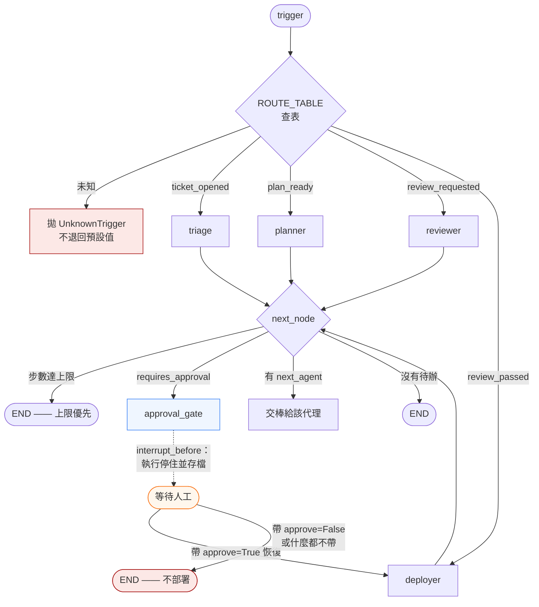
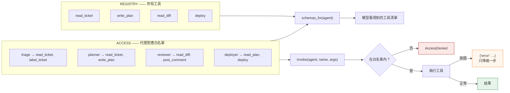

*[English](design.md) ｜ 繁體中文*

# 設計說明

README 的兩個主張，各配一張圖。

---

## 1. 控制平面是一張表，而核可是真的停住

`route()` 依 `trigger` 決定進入哪個節點。每個節點跑完後，`next_node()` 套用固定的優先序——**步數上限最先，其次是待核可，最後才是明確的交棒**。上限排第一，所以循環投不贏它。

虛線是整個系統唯一會等人的地方，而且是由執行層強制，不是靠某個節點記得要檢查。

**優先序本身是被測的**：`test_step_budget_outranks_a_pending_handoff` 在一個已超過步數上限的狀態上**同時**設了 `next_agent` 和 `requires_approval`，斷言執行仍然結束。

---

## 2. 權限在呼叫點檢查，而且與「對外宣告」同源

提示詞寫「不要部署」是一個請求。`ACCESS` 是一個檢查。提供給模型的 schema 由同一張表生成，所以**一個工具不可能被推薦給沒有權限執行它的代理**。

`test_schemas_offered_match_the_allow_list` 斷言這張共用表的**兩個輸出對每個代理都一致**。沒有這條，下次有人加工具時「宣告」與「檢查」就會開始各走各的。

---

## 每個主張對應哪條測試

| 主張 | 測試 |
|---|---|
| 同一 trigger 永遠走同一條路 | `test_same_trigger_always_routes_to_same_agent` |
| 型別與路由表不可能漂移 | `test_every_trigger_in_the_type_has_a_route` |
| 未知 trigger 拋錯而非預設 | `test_unknown_trigger_raises_instead_of_defaulting` |
| 控制平面碰不到模型 | `test_routing_touches_no_model` |
| 步數上限壓過交棒與核可 | `test_step_budget_outranks_a_pending_handoff` |
| 執行真的停在閘門 | `test_run_actually_stops_at_the_gate` |
| 沒有決定不等於同意 | `test_resuming_with_no_decision_still_refuses_to_deploy` |
| 審查者不能代替人核可 | `test_the_reviewer_cannot_approve_on_the_humans_behalf` |
| 宣告的 schema 等於白名單 | `test_schemas_offered_match_the_allow_list` |
| 工具拋錯只降級一步 | `test_a_raising_tool_degrades_instead_of_crashing` |
| 預算在串流中途就咬 | `test_stream_is_cut_mid_way_not_after_the_fact` |
| 真實用量覆寫估算值 | `test_real_usage_overwrites_the_estimate` |
| 診斷指標永不擋發布 | `test_the_diagnostic_metric_never_blocks_however_bad` |
| 兩個方向共用一條比較 | `test_both_directions_report_negative_z_when_worse` |
| 視窗太短不算 ok | `test_short_window_is_insufficient_data_not_ok` |
